<p align="center">
  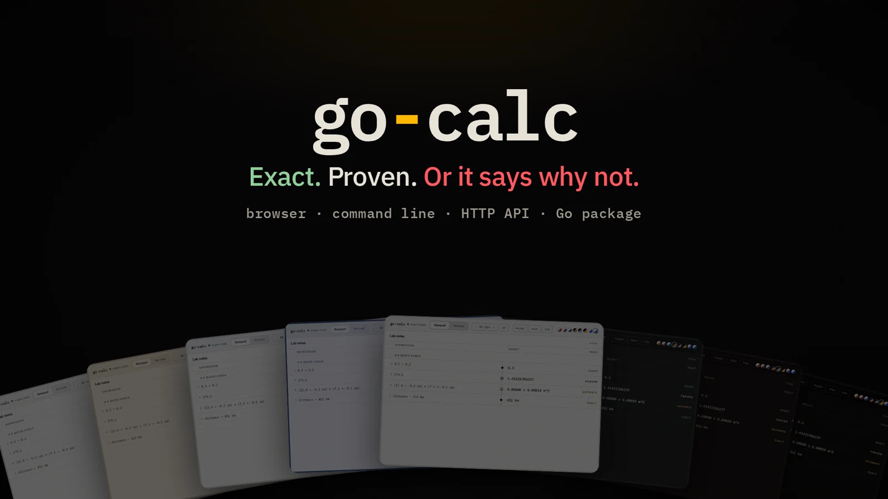
</p>

<p align="center">
  <b>A calculator that shows how far to trust its answers.</b><br>
  Every answer is exact, proven to guaranteed digits, an estimate with its uncertainty, or refused with the reason.
</p>

<p align="center">
  <a href="https://github.com/rahuldr07/go-calc/actions/workflows/ci.yml"></a>
  
  
  
</p>

<p align="center">
  <a href="https://rahuldr07.github.io/go-calc/"><b>Try it in your browser</b></a> ·
  <a href="#quick-start">Quick start</a> ·
  <a href="#a-tour">A tour</a> ·
  <a href="#the-web-app">Web app</a> ·
  <a href="#use-it-from-go">Go package</a> ·
  <a href="#how-it-works">How it works</a> ·
  <a href="#performance">Performance</a>
</p>

<p align="center">
  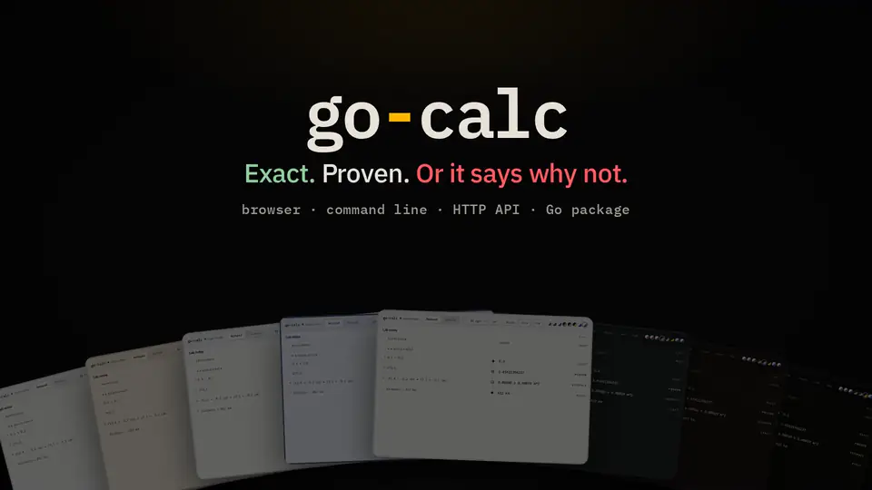
</p>

---

## Why

Most calculators hand you a number and leave you to wonder whether it is right. go-calc tells you.

| You type | A float64 calculator | go-calc | Trust |
|---|---|---|---|
| `0.1 + 0.2` | `0.30000000000000004` | `0.3` | **exact** |
| `(1e16 + 1) - 1e16` | `0` | `1`, and it names the `-` that lost 53 bits | **exact** |
| `2^100` | `1.2676506002282294e+30` | `1267650600228229401496703205376` | **exact** |
| `sqrt(2)` | `1.4142135623730951` | `1.41421356237`, every digit guaranteed | **proven** |
| `(12.4 ± 0.2 cm) * (7.1 ± 0.1 cm)` | not expressible | `0.00880 ± 0.00019 m^2` | **estimate** |
| `sqrt(2)*sqrt(2) == 2` | `false` | *undecided at this precision* | **error** |
| `5 m + 3 s` | `8` | *cannot add length (m) and time (s)* | **error** |

Every answer carries one of five trust labels, in the app, the CLI and the JSON:

| Label | Meaning |
|---|---|
| **exact** | Held as an exact number or fraction. Nothing was approximated anywhere. |
| **proven** | Bounded by a guaranteed interval. Every digit shown is certain. |
| **estimate** | Built from measured input, or from a test that is not a proof. It says which. |
| **held** | A definition, a list or a formula rather than a single number. |
| **error** | Refused, with the reason and where. It would rather say no than guess. |

## Quick start

**In the browser.** Open **[rahuldr07.github.io/go-calc](https://rahuldr07.github.io/go-calc/)**. Nothing to install, and the whole engine runs on your machine as WebAssembly, so nothing you type is sent anywhere. To run it yourself:

```bash
cd web
npm install
npm run wasm         # compiles the Go engine to WebAssembly
npm run dev
```

**On the command line.**

```bash
go install github.com/rahuldr07/go-calc/cmd/gocalc@latest
gocalc "0.1 + 0.2"
gocalc repl
```

Or from a clone:

```bash
go build -o gocalc ./cmd/gocalc
./gocalc "0.1 + 0.2"
./gocalc repl
```

**As an HTTP API.**

```bash
./gocalc serve --addr :8080
curl 'localhost:8080/v1/eval?expr=0.1%2B0.2'
```

**As a Go package.**

```go
import gocalc "github.com/rahuldr07/go-calc"

r, err := gocalc.Eval(ctx, "0.1 + 0.2")
// r.Text "0.3", r.Status gocalc.Exact, r.Exact "3/10", r.Float64 "0.30000000000000004"
```

## A tour

Every output below is real, copied from the CLI.

### Exact where it can be, proven where it cannot

```console
$ gocalc "1/3 + 1/6"
0.5

$ gocalc "2^100"
1267650600228229401496703205376

$ gocalc "pi < 22/7"
true

$ gocalc "round(pi, 3)"
3.142

$ gocalc "gamma(0.5)"
1.77245385091
```

Decimals are fractions, so `0.1` is exactly 1/10. Irrational results are computed as a ball, a midpoint with a rigorous radius, and precision doubles until every printed digit is guaranteed. A comparison is decided only when it can be proven; when the bounds overlap the answer is *undecided*, never a guess.

### Units that are checked

```console
$ gocalc "6.8 L/100km * 412 km in L"
28.016 L
  read as ((((6.8 L)/(100 km))·412) km) in L

$ gocalc "2 hours + 45 min in min"
165 min

$ gocalc "100 degF in degC"
340/9  ≈ 37.7777777778 degC

$ gocalc "5 m + 3 s"
cannot add length (m) and time (s)
```

SI and binary prefixes, imperial units, time, force, energy, power, pressure and temperature, all converted through exact rational factors. When an expression could be read two ways, go-calc prints the reading it took.

### Measured values

```console
$ gocalc "(12.4 +- 0.2 cm) * (7.1 +- 0.1 cm)"
0.00880 ± 0.00019 m^2
```

Uncertainty is propagated through first and second derivatives, the GUM method. Each result carries a contribution budget naming each input's share of the variance, and correlations can be declared. The ± is reported as a standard uncertainty, never dressed up as a guaranteed bound.

### Solving and calculus

```console
$ gocalc "solve(x^2 - 5x + 6 = 0, x)"
x = 2,  x = 3
  quadratic formula

$ gocalc "solve(cos(x) = x, x)"
x = 0.739085133215
  bisection on proven sign-change brackets
  searched [-100, 100]
  roots closer together than the grid step of 0.1, and roots where the curve only touches zero, can be missed

$ gocalc "deriv(sin(x^2), x)"
cos(x^2) * 2 * x
```

Exact roots where the algebra allows, proven brackets otherwise, and a plain statement of what a numerical search can miss.

### Whole numbers, statistics and more

```console
$ gocalc "factor(600851475143)"
71 · 839 · 1471 · 6857

$ gocalc "stdev([2, 4, 4, 4, 5, 5, 7, 9])"
2.1380899353
  read as the sample standard deviation: it divides by n - 1, and stdevp divides by n

$ gocalc "isprime(2^89 - 1)"
probably true
  a probable prime: it passes Miller-Rabin and Baillie-PSW, which no known number fools, but above 3.3 × 10^24 that is not a proof

$ gocalc "(1+2i)*(3+4i)"
-5+10i
```

81 functions in all: roots and powers, logarithms, trigonometry and its inverses, hyperbolics, rounding to places, `gcd`, `lcm`, `mod`, `modpow`, `factor`, `divisors`, `totient`, primes, Fibonacci, combinations, base conversion, statistics, list operations, `solve`, `deriv`, `gamma`, `erf`. Every one is documented inside the engine and the help page lists them with live examples.

### The working, step by step

```console
$ gocalc steps "gcd(48, 18)"
1. Find the greatest common divisor of 48 and 18: the largest whole number dividing them all
     gcd(48, 18) = 6
       48 = 2 × 18 + 12
       18 = 1 × 12 + 6
       12 = 2 × 6 + 0
       the last non-zero remainder is 6

Every step used exact arithmetic on whole numbers and fractions, so nothing was rounded and the answer is exact.
```

Each step explains itself in words, shows the arithmetic inside it, stays in the units you typed, and ends with why the answer can be trusted.

### Where floating point goes wrong

```console
$ gocalc why "(1e16 + 1) - 1e16"
proven:  1
float64: 0
they agree to no significant digits
printed in full, float64 gives 0, wrong in its last digit
where the digits went:
  53 bits at the - at 1:12
```

Every expression is also evaluated in float64 as a shadow, so go-calc can show you exactly which operation lost the digits.

### Typing help

```console
$ gocalc "sqre(4)"
1:1: unknown function sqre: did you mean sqrt?
```

## The web app

<p align="center">
  <picture>
    <source media="(prefers-color-scheme: dark)" srcset="docs/images/sheet-void.webp">
    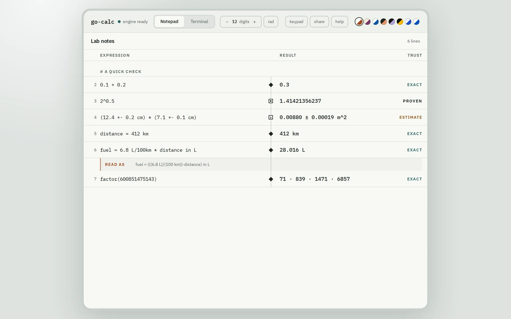
  </picture>
</p>

A live notepad. Type on any line and the answer appears beside it with its trust label. Lines can name values and use each other, and changing one updates everything that depends on it.

<table>
  <tr>
    <td width="50%">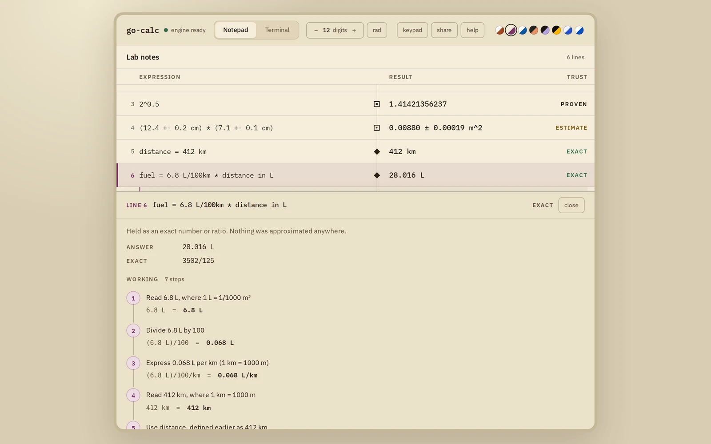</td>
    <td width="50%">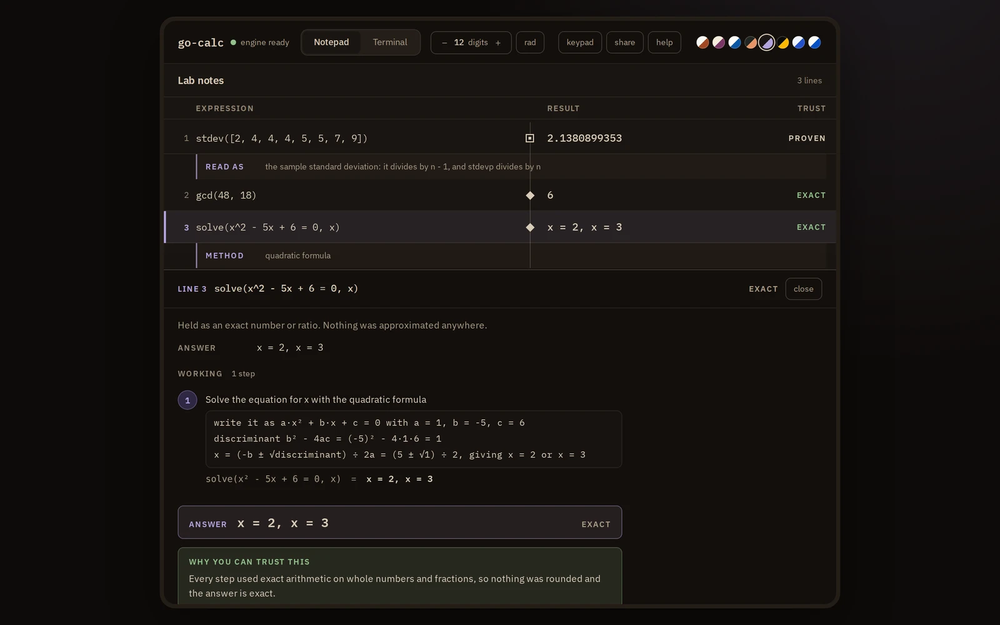</td>
  </tr>
  <tr>
    <td><b>Click any answer to see the working.</b> Each step in words, the arithmetic inside it, and why the answer can be trusted.</td>
    <td><b>Real arithmetic, not a summary.</b> The quadratic formula with its numbers, Euclid's divisions, a mean as the sum over the count.</td>
  </tr>
  <tr>
    <td>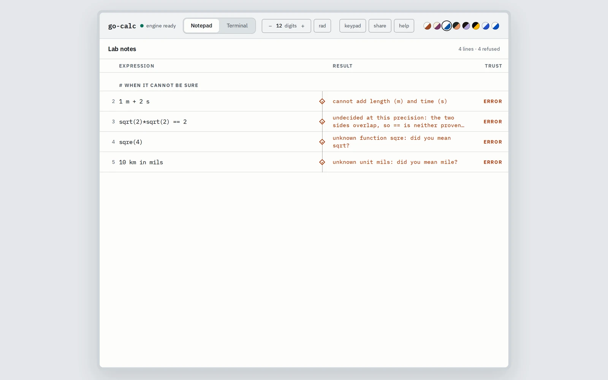</td>
    <td>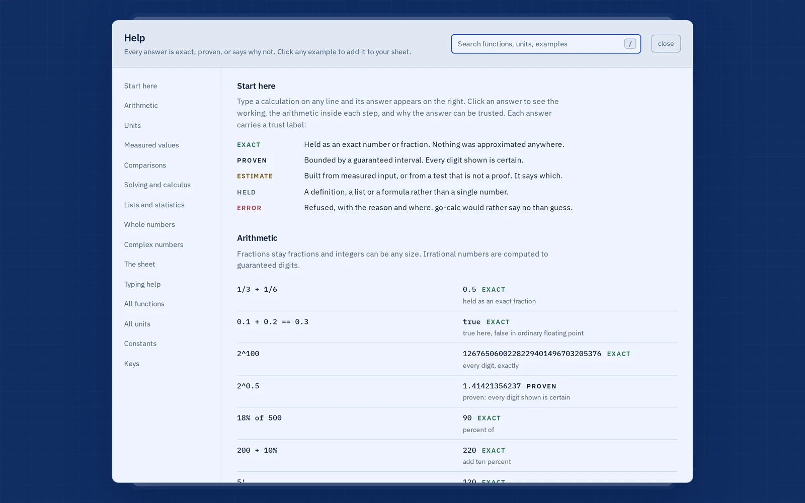</td>
  </tr>
  <tr>
    <td><b>It says no rather than guess</b>, and a misspelling gets a suggestion.</td>
    <td><b>A help page that cannot go stale.</b> Every example is computed live by the engine, with search.</td>
  </tr>
</table>

<p align="center">
  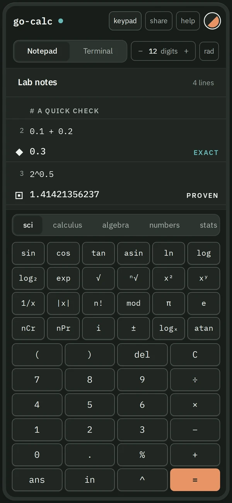
  &nbsp;&nbsp;&nbsp;
  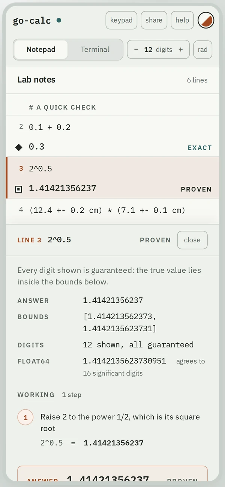
</p>

**Eight themes,** each audited to at least 4.5:1 contrast for every text the sheet and the working panel draw: Mineral, Vellum, Clearview (colour-blind safe), Blueprint, Proof, Spectrometer, Dimlight and Void.

<p align="center">
  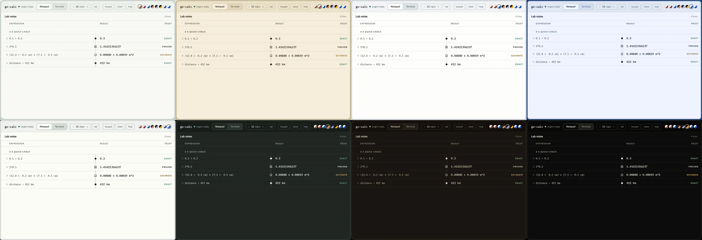
</p>

Also in the app: a terminal view over the same document, an optional scientific keypad, autocomplete that tolerates typos, share links that carry the whole sheet in the URL fragment so it never touches a server, and a layout that works on phones.

## Use it from Go

The engine is importable. `Eval` and `EvalSheet` run under a `context.Context` deadline and return typed results.

```go
package main

import (
	"context"
	"errors"
	"fmt"

	gocalc "github.com/rahuldr07/go-calc"
)

func main() {
	ctx := context.Background()

	sheet, _ := gocalc.EvalSheet(ctx, []string{
		"distance = 412 km",
		"fuel = 6.8 L/100km * distance in L",
	})
	fmt.Println(sheet.Results[1].Text, sheet.Results[1].Status) // 28.016 L exact

	pi, _ := gocalc.Eval(ctx, "pi", gocalc.Digits(30))
	fmt.Println(pi.Text, pi.Status) // 3.14159265358979323846264338328 proven

	_, err := gocalc.Eval(ctx, "1 m + 2 s")
	var refusal *gocalc.Refusal
	if errors.As(err, &refusal) {
		fmt.Println(refusal.Reason) // cannot add length (m) and time (s)
	}
}
```

Options: `Digits(n)`, `Degrees()`, `Timeout(d)`. A `Result` carries the status, the text, the exact value, the proven bounds, the unit, the uncertainty and what float64 would have said.

## Check calculations in CI

`gocalc check` treats `.calc` files like tests: it fails on any refusal, can require every answer to be exact or proven, and compares against a recorded `.golden` file.

```console
$ gocalc check examples/*.calc
examples/numbers.calc: 10 lines (10 exact) — ok
examples/physics.calc: 9 lines (2 exact, 4 proven, 3 estimate) — ok

$ gocalc check --require=exact trip.calc
trip.calc:2: area = pi * r^2 is proven, but exact is required
trip.calc: 2 lines (1 exact, 1 proven) — 1 problem
```

`--update` records the golden file, and inside GitHub Actions failures are printed as annotations on the right file and line. This repository checks its own `examples/` this way on every push.

## The HTTP API

```bash
gocalc serve --addr :8080 [--cors-origin https://example.com]
```

| Endpoint | |
|---|---|
| `GET /v1/eval?expr=…` | Evaluate one expression |
| `POST /v1/sheet` | Evaluate a whole sheet: `{"lines": [...], "digits": 12, "angle": "rad"}` |
| `GET /healthz` | Liveness |

```json
{
  "schema": "go-calc.sheet/1",
  "lines": [
    {
      "n": 0,
      "text": "0.3",
      "status": "exact",
      "digits": 1,
      "value": { "exact": "3/10", "decimal": "0.3", "digits": 1 },
      "float64": { "value": "0.30000000000000004", "agrees": 15.8 }
    }
  ]
}
```

Built on `net/http` alone, with read, write and idle timeouts, a 1 MiB body limit, a deadline that stops the engine mid-calculation, and a concurrency cap at the CPU count that answers `503` rather than queueing forever.

## How it works

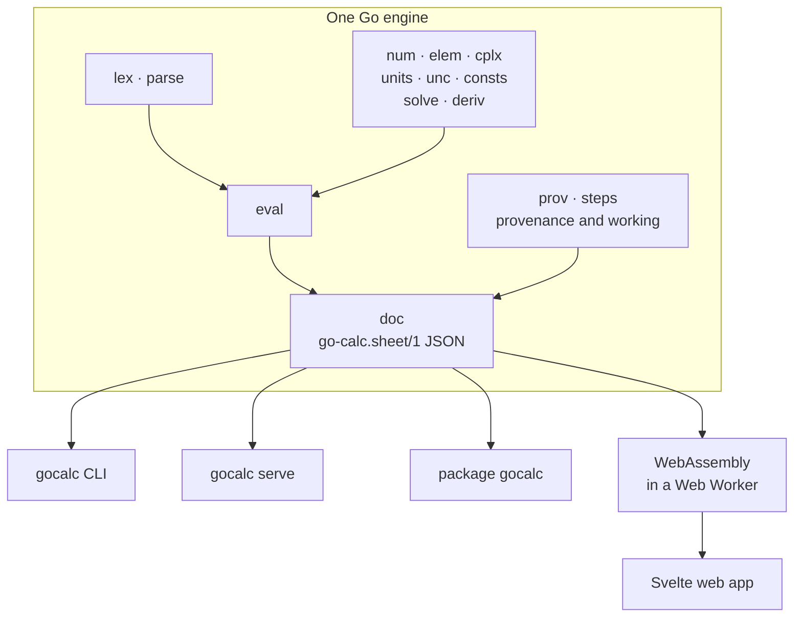

One engine, four front ends. The browser, the CLI, the HTTP API and the Go package all call the same code and exchange the same `go-calc.sheet/1` JSON, so they cannot disagree. The front ends format and never compute.

- **Exact rationals.** Numbers are `math/big` fractions until an operation genuinely needs an irrational.
- **Ball arithmetic.** Irrational values are a midpoint and a rigorous radius on `big.Float`, with outward rounding. Elementary functions, `gamma` and `erf` carry proven error bounds, and precision doubles until the requested digits are guaranteed or a stated limit is reached.
- **Measurement uncertainty.** First- and second-order propagation with contribution budgets and declared correlations.
- **The float64 shadow.** Each expression is also run in ordinary floating point, to show where it would have gone wrong.
- **Provenance.** Every value records where it came from, which drives `trace`, the working panel and the explanations.
- **Refusal.** Anything that cannot be stood behind, such as overlapping bounds, a mismatched unit or a number too large to write, is refused with the reason.

## Performance

Measured on a 12th Gen Intel Core i5-12400F under WSL2 with Go 1.26.5. Each figure is the median of three runs of `-benchtime 2s`.

| Budget | Measured |
|---|---|
| A typical 12-digit expression, under 1 ms | **0.44 ms** |
| 1,000 digits of `exp(pi·sqrt(163))`, under 1 s | **19.8 ms** |
| Recalculating a 100-line document, under 10 ms | **5.7 ms** |
| CLI cold start, under 50 ms | **4.2 ms** |
| The WebAssembly engine, under 4 MiB compressed | **1.64 MiB** gzipped (6.19 MiB raw) |

Other measured paths:

| What | Measured |
|---|---|
| One edit with a few dependents | 0.09 ms |
| One edit where 98 lines depend on it | 5.7 ms |
| A measured expression with its uncertainty budget | 0.23 ms |
| `sqrt(2) - sqrt(2)`, the slowest provably-zero case | 19.1 ms |
| A 100-line sheet through the JSON API, the browser's cost per keystroke | 10.1 ms |
| Ball multiplication at 120 bits | 1.25 µs |

The sizes: the `gocalc` binary is 11.1 MiB from `go build` and 7.8 MiB stripped; the web app's JavaScript is 130 KiB and its CSS 5.6 KiB, gzipped.

## Project layout

| Path | What lives there |
|---|---|
| `gocalc.go` | The public Go package |
| `cmd/gocalc` | The CLI: expressions, `repl`, `run`, `steps`, `why`, `trace`, `check`, `serve` |
| `internal/lex`, `internal/parse` | Tokens and the expression grammar |
| `internal/eval` | Evaluation, the function registry and its documentation |
| `internal/num`, `internal/elem` | Exact rationals, balls and proven elementary functions |
| `internal/units`, `internal/unc`, `internal/cplx` | Dimensions, uncertainty and complex numbers |
| `internal/solve`, `internal/deriv` | Root finding and symbolic derivatives |
| `internal/doc`, `internal/format`, `internal/prov` | Sheets, JSON, formatting and provenance |
| `internal/value`, `internal/consts`, `internal/suggest` | The value type, CODATA 2022 constants and typo suggestions |
| `internal/steps` | Worked explanations |
| `internal/server` | The HTTP API |
| `wasm/` | The WebAssembly entry point and build |
| `web/` | The Svelte 5 web app |
| `examples/` | Example sheets, checked in CI |

## Development

```bash
go test ./...                      # 683 tests across 20 packages
go vet ./...
go test ./internal/parse/ -run XXX -fuzz '^FuzzParse$' -fuzztime 60s

cd web
npm run wasm && npm run check && npm test && npm run build
```

Four fuzz targets cover the scanner, the parser and the sheet API. Tests guard the promises themselves: every engine function must have documentation, a working example and its own explanation; `gamma` and `erf` must enclose 80-digit reference values; primality must agree with a sieve; and no help example may drift from what the engine computes.

## Honest limits

- Physical constants come from CODATA 2022. A measured one such as `G` is used at its recommended value, and its standard uncertainty is not yet carried into results.
- Uncertainty is first and second order. Strongly nonlinear cases are flagged, not sampled.
- `solve` searches a grid and says so; roots closer together than the grid step can be missed.
- Complex numbers use rectangular balls, which can overestimate the radius.
- Definite integrals, matrices, dates and currency are not built yet.

## Related work

go-calc does not claim firsts. [Qalculate!](https://qalculate.github.io/) has offered exact and approximate modes, CODATA constants and interval arithmetic for years, and [Graphest](https://graphest.com/) draws guaranteed graphs. go-calc's focus is telling you, answer by answer, how far to trust what you see.

## License

No license has been chosen yet, so all rights are reserved by the author.
